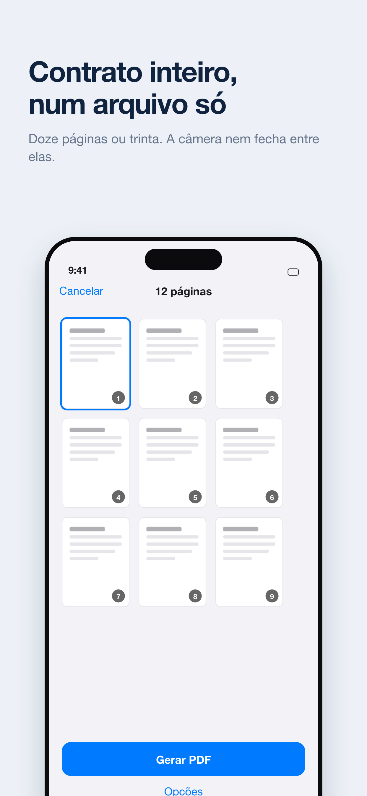
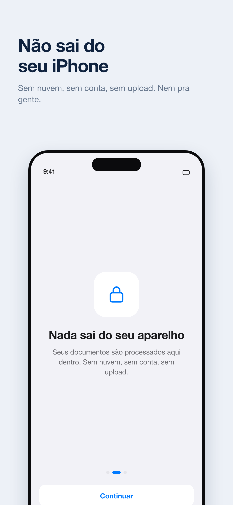
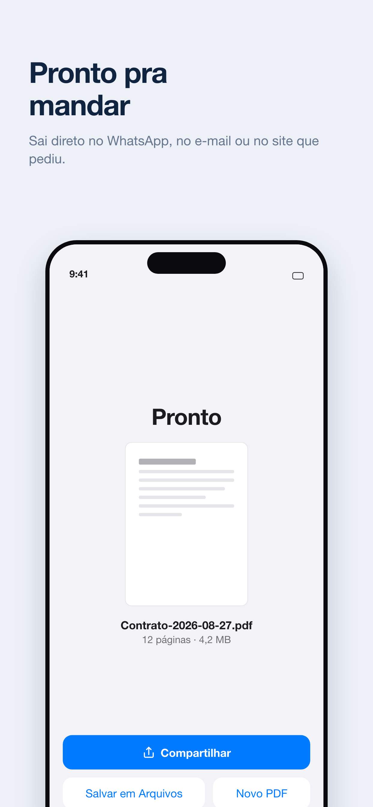

# Manda em PDF

App que transforma papel em PDF pronto para enviar — contrato, escritura, matrícula de imóvel, procuração, nota fiscal, boleto, certidão — com tudo processado no aparelho: sem servidor, sem conta, sem upload.

[Baixar na App Store](https://apps.apple.com/br/app/manda-em-pdf/id6806063899)

<p>
  
  
  
  
  
</p>

## Principais funcionalidades

- Captura pela câmera com detecção de bordas e correção de perspectiva; importação de imagens das Fotos e do app Arquivos.
- Montagem do documento: reordenar, girar, recortar e excluir páginas; filtros (original, preto e branco, escala de cinza, clarear).
- Geração do PDF em A4 ou Carta, retrato ou paisagem, e envio pela folha de compartilhamento nativa.
- Presets por tipo de documento (contrato, imóvel, procuração, nota fiscal, boleto, RG, CNH), já com filtro, papel e nome certos.
- Histórico dos PDFs gerados, com reenviar e apagar.
- Grátis para PDFs de 1 ou 2 páginas, para sempre. Uma compra única libera multipágina, fusão de frente e verso, OCR (PDF pesquisável) e compressão com alvo de tamanho.
- Sem analytics, sem conta, sem nuvem.

## Stack técnica

- TypeScript, React Native 0.83 / React 19.2 com Expo SDK 55 (expo-router)
- expo-sqlite + Drizzle ORM (banco local com migrations versionadas)
- expo-print (geração do PDF), expo-text-extractor (OCR), react-native-document-scanner-plugin (scanner)
- expo-iap (compra única)
- Jest (jest-expo) e ESLint
- Alvos: iOS 15.1+ e Android 7.0+ (o lançamento foi iOS primeiro)

A escolha do SDK 55 é deliberada e está justificada na seção 4.5 da spec: o SDK 56+ exige Xcode 26.4, que exige macOS Tahoe.

## Como foi construído

Desenvolvido com Claude (Anthropic) a partir de uma especificação SDD: [spec.md](spec.md). A spec define princípios, escopo, modelo de dados, regras de negócio, máquinas de estado e critérios de aceite. O repositório tem estes guardrails:

- [`CLAUDE.md`](CLAUDE.md) com o guia do agente: comandos, "pegadinhas que não podem ser quebradas" (por exemplo, nenhum preço no código, o fluxo gratuito de até 2 páginas nunca encosta em paywall, nenhuma biblioteca com acesso à rede além da compra, nenhum analytics), convenções e mapa do código.
- Testes Jest em `src/lib/__tests__/` e `src/services/__tests__/` cobrindo regras de negócio, nome de arquivo, datas, compressão, edição de página e montagem do PDF (inclui teste de regressão do tamanho de página).
- Verificação local com `npm run typecheck && npm test && npm run lint`.

Documentação complementar:

- Modelo de dados: [`modelo-manda-em-pdf.dbml`](modelo-manda-em-pdf.dbml) e [`SCHEMA.md`](SCHEMA.md)
- Telas: fontes em [`design/`](design/) (protótipos do Claude Design)
- Pendências e decisões: [`DECISOES.md`](DECISOES.md)
- Como o sistema ficou: [`DOCUMENTACAO-TECNICA.md`](DOCUMENTACAO-TECNICA.md)

## Status

Publicado na App Store (iOS). A versão Android está no código, mas não há link de loja publicado.

## Licença

O código está disponível apenas para leitura e estudo. Veja [LICENSE](LICENSE).

## Contribuições

Issues são bem-vindas; pull requests não são aceitos. Veja [CONTRIBUTING.md](CONTRIBUTING.md).

## Como rodar

Requisitos: Node 20.19.4+, Xcode 26+, CocoaPods, Android SDK (JDK 17 para o Android).

```bash
npm install
npx expo prebuild                                        # gera ios/ e android/
LANG=en_US.UTF-8 LC_ALL=en_US.UTF-8 npx expo run:ios
LANG=en_US.UTF-8 LC_ALL=en_US.UTF-8 npx expo run:android
```

> **`LANG` é obrigatório.** O CocoaPods falha sem locale UTF-8, com um erro que não diz qual é a causa.

O scanner **não funciona no simulador** (não há câmera). Use "Escolher das Fotos" para exercitar o fluxo, ou rode em aparelho físico.

Verificar:

```bash
npm run typecheck && npm test && npm run lint
```

### Banco de dados

Duas tabelas locais, nomes em português (seção 7 da spec): `documentos` (histórico dos PDFs) e `preferencias` (chave-valor). Migrations versionadas pelo Drizzle Kit e aplicadas na abertura do app.

Alterou `src/db/schema.ts`? Rode `npm run db:generate` e atualize o `.dbml`.

### Variáveis de ambiente

**Não existem.** O app não tem servidor, chave de API nem analytics. O id do produto de compra é constante pública no código, não segredo.

### Publicar

Build e submissão por EAS (`eas.json`). A chave da App Store Connect fica em `secrets/`, que não é versionado.

---

Feito pela [Dab Lab](https://www.dablab.com.br/) — agência de inovação no-code para startups e PMEs, com automações usando IA.
