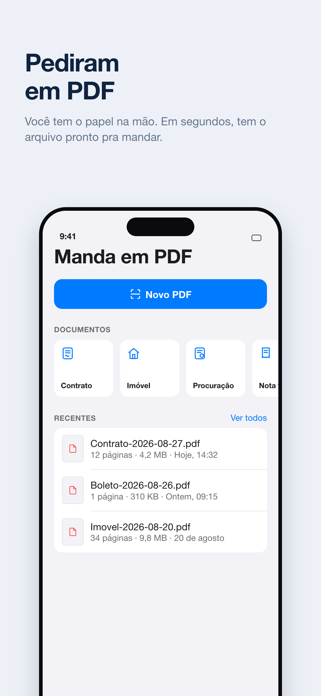
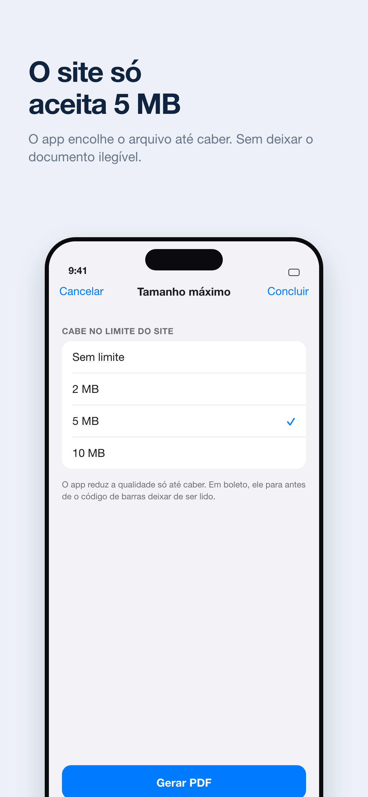

# Manda em PDF

<p align="center">
  
  &nbsp;
  
  &nbsp;
  
</p>

<p align="center">
  <a href="https://apps.apple.com/br/app/manda-em-pdf/id6806063899"><b>Baixar na App Store</b></a> ·
  <a href="spec.md">Especificação</a> ·
  <a href="LICENSE">Licença</a>
</p>

O **Manda em PDF** transforma papel em PDF pronto para enviar: contrato assinado à mão, escritura e matrícula que vieram do cartório, procuração, nota fiscal em papel térmico, boleto impresso, certidão, recibo. Aponte a câmera, o app endireita a página sozinho e devolve o arquivo pronto para mandar no WhatsApp, no e-mail ou anexar naquele site que só aceita PDF.

Não é um conversor genérico de foto em PDF: o app muda a forma de capturar, o filtro, o recorte e a compressão conforme o tipo de documento. Contrato e escritura capturam em lote, com a câmera aberta entre as páginas. Nota fiscal ganha contraste reforçado para papel térmico desbotado e não é forçada na proporção A4. Boleto tem piso de compressão, porque um boleto menor e ilegível não serve para nada.

Tudo é processado no aparelho: sem servidor, sem conta, sem upload, sem analytics.

É um produto da [Dab Lab](https://www.dablab.com.br/).

## As telas do app

<p align="center">
  
  &nbsp;
  
</p>

- **Escanear** com detecção automática de borda e correção de perspectiva, ou importar imagens das Fotos e do app Arquivos.
- **Montar o documento**: reordenar, girar, recortar e excluir páginas, com filtros (original, preto e branco, escala de cinza, clarear).
- **Atalhos por tipo de documento** — contrato, imóvel, procuração, nota fiscal, boleto, RG, CNH — já com o filtro, o papel e o nome de arquivo certos.
- **Gerar o PDF** em A4 ou Carta, retrato ou paisagem, e enviar pela folha de compartilhamento do sistema.
- **Histórico** dos PDFs gerados, para reenviar sem escanear de novo.

## Quanto custa

PDFs de uma ou duas páginas são grátis, para sempre, sem anúncio, sem marca d'água e sem contador de uso. Uma compra única de R$ 29,90 — sem assinatura — libera documentos com quantas páginas precisar, ajuste de tamanho para caber no limite de upload do site, PDF com texto pesquisável (OCR no aparelho) e a fusão de frente e verso de RG e CNH numa página só.

## Stack técnica

- TypeScript, React Native 0.83 / React 19.2 com Expo SDK 55 (expo-router)
- expo-sqlite + Drizzle ORM (banco local com migrations versionadas)
- expo-print (geração do PDF), expo-text-extractor (OCR), react-native-document-scanner-plugin (scanner)
- expo-iap (compra única)
- Jest (jest-expo) e ESLint
- Alvos: iOS 15.1+ e Android 7.0+ (o lançamento foi iOS primeiro)

A escolha do SDK 55 é deliberada e está justificada na seção 4.5 da spec: o SDK 56+ exige Xcode 26.4, que exige macOS Tahoe.

## Como foi construído

Desenvolvido com Claude (Anthropic) a partir de uma especificação SDD: [spec.md](spec.md). A spec define princípios, escopo, modelo de dados, regras de negócio, máquinas de estado e critérios de aceite. O repositório tem estes guardrails:

- [`CLAUDE.md`](CLAUDE.md) com o guia do agente: comandos, "pegadinhas que não podem ser quebradas" (por exemplo, nenhum preço no código, o fluxo gratuito de até 2 páginas nunca encosta em paywall, nenhuma biblioteca com acesso à rede além da compra, nenhum analytics), convenções e mapa do código.
- Testes Jest em `src/lib/__tests__/` e `src/services/__tests__/` cobrindo regras de negócio, nome de arquivo, datas, compressão, edição de página e montagem do PDF (inclui teste de regressão do tamanho de página).
- Verificação local com `npm run typecheck && npm test && npm run lint`.

Documentação complementar:

- Modelo de dados: [`modelo-manda-em-pdf.dbml`](modelo-manda-em-pdf.dbml) e [`SCHEMA.md`](SCHEMA.md)
- Telas: fontes em [`design/`](design/) (protótipos do Claude Design)
- Pendências e decisões: [`DECISOES.md`](DECISOES.md)
- Como o sistema ficou: [`DOCUMENTACAO-TECNICA.md`](DOCUMENTACAO-TECNICA.md)

## Status

Publicado na App Store (iOS). A versão Android está no código, mas não há link de loja publicado.

## Contribuições

Issues são bem-vindas; pull requests não são aceitos. Veja [CONTRIBUTING.md](CONTRIBUTING.md).

## Como rodar

Requisitos: Node 20.19.4+, Xcode 26+, CocoaPods, Android SDK (JDK 17 para o Android).

```bash
npm install
npx expo prebuild                                        # gera ios/ e android/
LANG=en_US.UTF-8 LC_ALL=en_US.UTF-8 npx expo run:ios
LANG=en_US.UTF-8 LC_ALL=en_US.UTF-8 npx expo run:android
```

> **`LANG` é obrigatório.** O CocoaPods falha sem locale UTF-8, com um erro que não diz qual é a causa.

O scanner **não funciona no simulador** (não há câmera). Use "Escolher das Fotos" para exercitar o fluxo, ou rode em aparelho físico.

Verificar:

```bash
npm run typecheck && npm test && npm run lint
```

### Banco de dados

Duas tabelas locais, nomes em português (seção 7 da spec): `documentos` (histórico dos PDFs) e `preferencias` (chave-valor). Migrations versionadas pelo Drizzle Kit e aplicadas na abertura do app.

Alterou `src/db/schema.ts`? Rode `npm run db:generate` e atualize o `.dbml`.

### Variáveis de ambiente

**Não existem.** O app não tem servidor, chave de API nem analytics. O id do produto de compra é constante pública no código, não segredo.

### Publicar

Build e submissão por EAS (`eas.json`). A chave da App Store Connect fica em `secrets/`, que não é versionado.

## Licença

O código está aberto para leitura e estudo, nos termos do [LICENSE](LICENSE).

Feito pela [Dab Lab](https://www.dablab.com.br/), product studio de software e IA que constrói apps para pequenas empresas, startups e áreas dentro de grandes empresas, partindo de uma especificação (Spec-Driven Development) e com as disciplinas de engenharia de software robusta.
